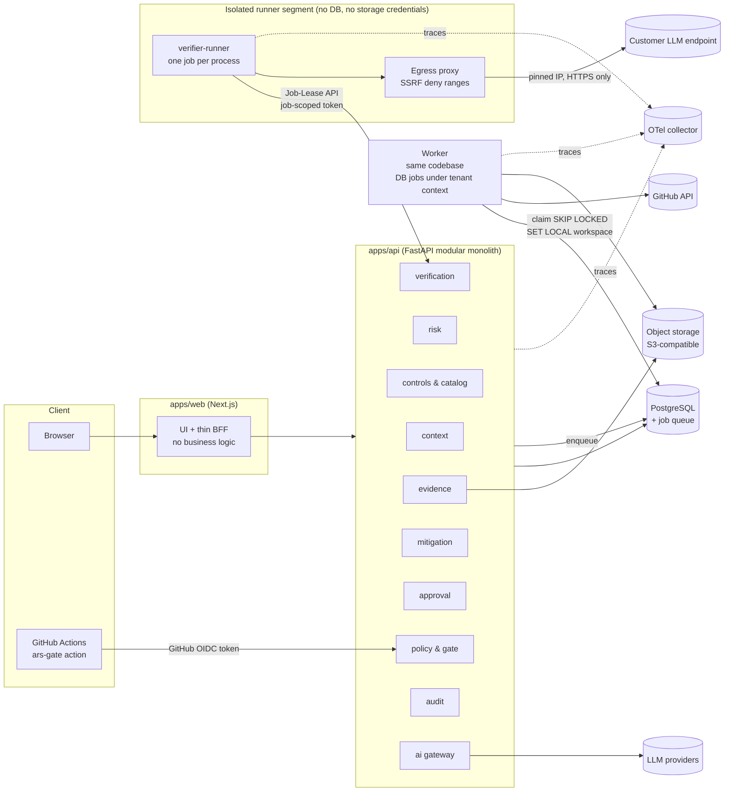

# MVP Architecture

> Status: **Draft for approval** · Each **ADR-xxx** below has a matching file in [`docs/adr/`](../adr/README.md) with status *Proposed*.

## 1. Architectural drivers

1. **Integrity and traceability** of evidence and decisions (the product's core promise).
2. **Tenant isolation** and safe handling of confidential product context.
3. **Safe execution** of verifiers that touch external systems (GitHub, user LLM endpoints).
4. **Provider-agnostic, evaluable AI** with provenance.
5. **Solo-builder operability:** minimal moving parts, cheap to run, easy to demo.

## 2. Style: modular monolith + async worker (ADR-0001)

One deployable backend (FastAPI) with strict internal module boundaries, plus a worker process from the same codebase for long-running jobs. No microservices in MVP.

*Why:* fastest path with clear seams; modules can be extracted later (verifier runner is the most likely first extraction).



## 3. Components

| Component | Responsibility | Key tech |
|---|---|---|
| `apps/web` | UI, auth session, calls API via generated typed client | Next.js (App Router), TypeScript, Tailwind, shadcn/ui, TanStack Query, openapi-typescript |
| `apps/api` | Domain logic, REST API (OpenAPI), authZ, policy evaluation | Python 3.12, FastAPI, Pydantic v2, SQLAlchemy 2, Alembic |
| Worker | Discovery jobs, GitHub posture checks, report generation, scheduled re-verification | Same package; Postgres-backed queue (ADR-0004); runs under tenant context |
| Verifier runner | LLM endpoint probes (customer-chosen targets) | Separate process type and network segment; no DB or storage credentials; work via the [Job-Lease API](job-lease-api.md) |
| `catalog/` | Risk catalog, control catalog, framework mappings, probe suites, default policies (YAML + JSON Schema) | Validated in CI |
| AI gateway | Provider interface, structured output, retries, token budgets, provenance logging | Own thin interface (ADR-0005) |
| Gate action | GitHub Action calling Gate API, posting Check Run | TypeScript action in `integrations/github-action` |

## 4. Key technical decisions (recommended)

| ADR | Decision | Alternatives considered | Rationale |
|---|---|---|---|
| ADR-0001 | Modular monolith + worker | Microservices; serverless functions | Lowest ops cost; clear seams for later extraction. |
| ADR-0002 | Monorepo (`apps/`, `packages/`, `catalog/`, `docs/`) | Polyrepo | One PR can change API + UI + catalog + docs; better portfolio readability. |
| ADR-0003 | PostgreSQL as system of record; tenant_id on every row, enforced in repository layer + **Postgres RLS** as defense in depth | Schema-per-tenant | Simple, testable isolation; RLS catches application bugs. |
| ADR-0004 | Postgres-backed job queue (`SELECT … FOR UPDATE SKIP LOCKED`, e.g. Procrastinate); metadata-only queue table with dedicated roles; isolated runner gets work via the Job-Lease API | Celery + Redis; cloud queues | One less infra component; sufficient throughput for MVP. |
| ADR-0005 | Own `LLMProvider` protocol + adapters (Anthropic, OpenAI; optional local) | LiteLLM; LangChain | Small surface, full control of provenance/evals; can wrap LiteLLM later if adapters multiply. |
| ADR-0006 | Policies as declarative YAML evaluated by a small Python engine, behind a `PolicyEngine` interface | OPA/Rego; Cedar | PM-readable policies; no new language for users; keep OPA as future engine. |
| ADR-0007 | Evidence content-addressed (SHA-256) in object storage, metadata in Postgres, write-once | Store blobs in Postgres | Immutability, cheap storage, natural dedup. |
| ADR-0008 | Audit log append-only table with hash chain (`hash = sha256(prev_hash ‖ canonical_event)`), DB role without UPDATE/DELETE | External ledger; event sourcing | Tamper-evidence at low complexity; verifiable by a CLI command. |
| ADR-0009 | AuthN via OIDC (GitHub + Google) using Auth.js in web; BFF pattern with 60 s identity-only JWTs from the web server to the API; CI uses GitHub Actions OIDC (scoped API tokens as fallback) | Clerk/Auth0 (managed); Keycloak | Free, standard, GitHub login fits audience. **Q5 approved 2026-10-16**; ADR text pending acceptance. |
| ADR-0010 | AuthZ: RBAC per workspace (`owner, admin, product, engineer, security, grc, viewer`) checked in a single policy module | ABAC from day 1 | Enough for MVP; tested by permission matrix. |
| ADR-0011 | Verifiers run in the worker with **egress allow-list, timeouts, no shared credentials**; endpoint ownership verification required | Run in customer CI only | Safe-by-default; supports both modes later. |
| ADR-0012 | OpenTelemetry SDKs in web/api/worker; GenAI semantic conventions for LLM spans | Vendor SDKs | Vendor-neutral; showcases AI observability. |
| ADR-0013 | API contract-first: FastAPI OpenAPI → generated TS client; breaking changes checked in CI | GraphQL; tRPC | Python backend makes REST/OpenAPI the natural boundary. |
| ADR-0014 | Python tooling: `uv`, `ruff`, `mypy --strict` on domain; JS: `pnpm`, ESLint, Prettier | Poetry, Black | Fast, modern, single-tool linting. |
| ADR-0015 | Local dev via Docker Compose (Postgres, MinIO, OTel collector, Jaeger) | Cloud dev envs | Reproducible, offline-friendly. |
| ADR-0016 | Free-tier hosting for a non-commercial educational project: Vercel Hobby for web (subject to its terms and limits); free tiers for API, PostgreSQL, object storage and runner; capabilities that cannot be hosted safely for free stay local (Docker Compose) | Paid PaaS; AWS ECS/Fargate | Zero cost; security architecture unchanged. **Q6 approved 2026-10-16**; ADR text pending acceptance. No paid service without explicit authorization. |

## 5. Backend module structure

```text
apps/api/src/ars/
  modules/
    context/      # products, releases, system profiles
    risk/         # risk instances, ratings, discovery orchestration
    controls/     # catalog loader, mappings
    verification/ # verifier registry, runs, results
    evidence/     # evidence store, hashing, expiry
    mitigation/   # backlog, GitHub Issues export
    approval/     # approvals, overrides
    policy/       # policy engine, gate decisions
    audit/        # append-only hash-chained log
    identity/     # users, workspaces, roles, API tokens
  ai/             # LLMProvider protocol, adapters, prompts/, schemas
  verifiers/      # github_posture/, llm_probe/  (plugin interface)
  platform/       # db, settings, otel, queue, storage
```

Rules: modules communicate via service interfaces, not each other's tables; enforced with `import-linter` in CI.

## 6. Key flows

**Risk discovery:** UI → `POST /releases/{id}/discoveries` → job → AI gateway (profile + candidate catalog entries) → schema-validated suggestions → stored as `suggested` → UI review → accept/reject → audit events.

**Verification:** user triggers or schedule → job → verifier plugin → raw output → evidence object (hashed, stored) → verification result → audit event.

**Release gate:** CI action → `POST /gate/evaluate {release_id}` with a GitHub OIDC token (repository and commit come from the token, scoped API token only as a labelled fallback) → API resolves the pull request `head_sha` → policy engine over the evidence snapshot for that commit → signed decision persisted (head_sha, policy version and digest, evidence snapshot digest, expires_at) → Check Run on `head_sha`. Details: [release gate binding](release-gate-binding.md).

## 7. Data model sketch (core tables)

`workspaces, users, memberships, api_tokens, jobs (platform, metadata only), products, releases, system_profiles(versioned), catalog_versions, risks, risk_ratings, controls_applied, verification_runs, verification_results, evidence(sha256, uri, type, valid_until), evidence_links, mitigations, approvals, policies(versioned), gate_decisions, audit_events(prev_hash, hash), ai_invocations(model, provider, prompt_version, input_hash, tokens, cost, latency)`.

## 8. Testing strategy

| Layer | Tooling | Focus |
|---|---|---|
| Unit | Pytest, Vitest | Policy engine, scoring, hash chain, schema validation |
| Integration | Pytest + Testcontainers (Postgres, MinIO) | Repositories, RLS isolation, job flow |
| Contract | Schemathesis on OpenAPI; generated client type-check | API conformance |
| AI evals | Pytest-based eval harness over golden profiles; recorded fixtures for CI, live eval nightly | Precision/recall, schema validity, injection resistance |
| E2E | Playwright | Golden path, permission matrix, accessibility (axe) |
| Security | Semgrep, Bandit, pip-audit, npm audit, gitleaks, Trivy (images), OWASP ZAP baseline (M5) | Supply chain + app security |

## 9. Observability

Traces across web → api → worker → LLM; metrics: gate latency, job durations, LLM tokens/cost per workspace, verifier failure rates; structured logs with trace IDs; no prompt bodies with customer data in logs by default (configurable redaction).

## 10. Detailed designs (architecture review)

| Topic | Document |
|---|---|
| Endpoint verifier authorization, SSRF, isolation and limits | [Endpoint verifier security](../security/endpoint-verifier-security.md) |
| Job queue roles and the runner Job-Lease API | [Job queue and Job-Lease API](job-lease-api.md) |
| Gate binding to commit, policy version and evidence | [Release gate binding](release-gate-binding.md) |
| Evidence integrity, retention, access and deletion | [Evidence model](evidence-model.md) |
| Audit log guarantees and limits | [Audit log integrity](../security/audit-log-integrity.md) |
| Multi-tenant isolation, RLS, frontend ↔ backend authZ | [Tenant isolation & authZ](../security/tenant-isolation-and-authz.md) |
| Automated vs human vs documentary verification | [Verification methods](../governance/verification-methods.md) |

## 11. Internationalization readiness

Decision Q4 (approved): English (en-US) is the only language in v0.1, but the frontend must not need a major refactor to add pt-BR later.

- All user-facing strings (UI, validation messages, notifications, report templates) live in **message catalogs** (`apps/web/messages/en-US.json`) using ICU MessageFormat. A catalog-based library is used (candidate: `next-intl`, confirmed at scaffold time). No hard-coded strings in components; a lint rule enforces this.
- Dates, numbers and currencies are formatted with `Intl` APIs through locale-aware helpers. The locale is fixed to `en-US` in v0.1.
- Routing is designed to allow a locale segment later without breaking URLs (no locale prefix in v0.1).
- API error responses return stable **error codes** plus English messages. The UI maps codes to catalog messages.
- Report templates (Markdown/PDF) are also catalog-driven.
- Regulatory content (framework names, article and control identifiers, official terms) is **not** translated or paraphrased into other terminology. It is stored as catalog data with its official form.
- No translation services and no multilingual UI in the MVP.

## 12. Deliberately deferred

Event streaming, multi-region, SSO/SAML, fine-grained ABAC, runtime monitoring agents, plugin marketplace, on-prem.
