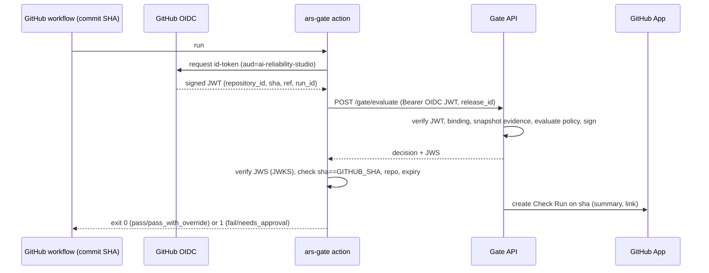

# Release Gate Binding Specification

> Status: **Proposed** (architecture review, M0) · Related: [ADR-0006](../adr/0006-declarative-policy-engine.md), [threat model](../security/threat-model.md) T01, T20, [evidence model](evidence-model.md)
> Goal: a gate decision is valid **only** for one exact commit, one exact policy version and one exact set of evidence. Anyone (including an auditor) can recompute and verify it later.

## 1. Decision subject

A gate decision is computed over this tuple. Every element is recorded in the decision.

| Element | Source | Notes |
|---|---|---|
| `workspace_id`, `product_id`, `release_id` | Release configuration | The release is linked to one repository |
| `repository_id` + `repository` | **GitHub OIDC token claims** | The numeric ID guards against repository renames or transfers |
| `commit_sha` | **GitHub OIDC token `sha` claim** | Full 40-hex SHA; short SHAs are rejected |
| `ref`, `workflow_ref`, `run_id`, `run_attempt` | GitHub OIDC token claims | Context, used in the audit trail |
| `policy_id`, `policy_version`, `policy_digest` | Policy store | `policy_digest` = SHA-256 of the canonical policy document |
| `catalog_version` | Catalog store | Version of risk/control catalog used |
| `evidence_snapshot_digest` | Computed (§3) | Exact set of verification results and evidence used |
| `engine_version` | Build metadata | Version of the policy engine code |

**Key property:** the commit and repository come from a **GitHub-signed OIDC token**, not from the request body. A workflow cannot ask for a decision about a commit it is not running on.

## 2. Authenticating the CI request

1. **Preferred (MVP): GitHub Actions OIDC.** The `ars-gate` action requests an OIDC token with audience `ai-reliability-studio`. The API checks the signature against GitHub's JWKS and checks `iss`, `aud`, `exp` and `iat` (allowing for clock skew). It then looks up a **repository binding** (workspace + release ↔ `repository_id`) that a workspace admin created, so no long-lived secret lives in the repository.
2. **Fallback: scoped API token.** This is for self-hosted runners or other CI. The token is bound to one repository and has a single permission, `gate:evaluate`. It is stored hashed (Argon2id or HMAC-SHA-256 with pepper), expires after at most 90 days and is revocable. In this mode the SHA comes from the request, so decisions are flagged `subject_assertion: "client"` and policies can refuse them.

## 3. Evidence snapshot

At evaluation time the engine collects, for every control in scope of the release:

```json
{ "control_id": "ARS-LLM-01",
  "verification_result_id": "0192…",
  "status": "verified|attested|failed|not_verified|not_applicable",
  "method": "automated_test|human_review|documentary",
  "evidence": [{ "evidence_id": "0192…", "sha256": "…", "valid_until": "2026-11-14T00:00:00Z", "binding": "commit|release|time" }] }
```

- The list is sorted by `control_id` and canonicalized with **RFC 8785 (JCS)**. `evidence_snapshot_digest = SHA-256(canonical bytes)`.
- The full snapshot is stored immutably with the decision.

### Evidence binding types

| Binding | Meaning | Valid for this decision when |
|---|---|---|
| `commit` | Evidence produced for a specific commit (e.g., probe run against a preview deployment that reports this SHA, CI test report for this SHA) | `evidence.commit_sha == decision.commit_sha` |
| `release` | Evidence about the release scope regardless of commit (e.g., DPIA document, human design review) | Same `release_id` and not expired |
| `time` | Point-in-time state (e.g., repository posture) | `collected_at` within the policy's freshness window and not expired |

Policies declare which binding each control requires, for example: *"ARS-LLM-01 requires `commit`-bound automated evidence; ARS-GOV-03 accepts `release`-bound documentary evidence."* Evidence with the wrong binding counts as `not_verified`.

## 4. Policy versioning

- Policies are **immutable versions**. Editing creates a new version, and a version becomes `active` only after an approval by `security` or `admin` (an audit event).
- A release pins either a specific `policy_version` or follows `active`. Either way, the decision records the exact version and digest that was evaluated.
- Changing a policy never changes past decisions. Re-running the gate produces a **new** decision.
- Regression scenarios (`catalog/policies/tests/`) run in CI on every policy change. Example: "a release with an unverified high-risk control must fail."

## 5. Decision record

| Field | Description |
|---|---|
| `decision_id` | UUIDv7 |
| subject fields | All of §1 |
| `outcome` | `pass`, `fail`, `needs_approval`, `pass_with_override` |
| `reasons[]` | Rule ID, control ID, status, explanation (plain language) |
| `approvals[]` | Approval IDs that satisfied `needs_approval` (§6) |
| `evaluated_at`, `expires_at` | Default TTL 24 h; maximum 7 days |
| `inputs_digest` | SHA-256 of JCS(subject + `policy_digest` + `evidence_snapshot_digest` + `engine_version`) |
| `signature` | Compact **JWS (EdDSA / Ed25519)** over the decision payload |

- **Signing key:** a dedicated Ed25519 key, held in a KMS or secret manager and separate from database credentials. Public keys are published at `/.well-known/jwks.json` with `kid` rotation. Asymmetric signatures let third parties verify a decision without any shared secret.
- **Idempotency:** if the same `inputs_digest` is evaluated again while an unexpired decision exists, the API returns the existing decision.

## 6. Approvals and overrides

- `needs_approval` lists the required roles. Each approval is bound to the **`decision_id`**, and therefore to its commit, policy and evidence. A new commit requires new approvals unless the policy explicitly allows carry-over for unchanged controls.
- An override (`fail` → `pass_with_override`) requires `owner` or `security`, recent authentication, a justification of at least 30 characters and an expiry. The new decision references the original decision and the approval.

## 7. Enforcement in GitHub



- Branch protection must require the **Check Run** posted by the GitHub App, not just the workflow step. A modified workflow cannot spoof that check, because only our App can post it.
- **Failure mode:** if the API is unreachable, the gate fails **closed** by default. A policy may opt into fail-open for non-protected branches. Break-glass overrides are audited.

## 8. Independent verification

`ars verify-decision <decision_id>` (CLI and API) does the following:

1. Fetches the decision, the snapshot and the policy version.
2. Recomputes `policy_digest`, `evidence_snapshot_digest` and `inputs_digest`.
3. Verifies the JWS against the published JWKS.
4. Checks that each referenced evidence object still hashes to its recorded SHA-256, or is shown as a tombstone if it was deleted.
5. Checks that the decision's audit events are present in a verified audit chain.

## 9. Tests

All automated: replay with another SHA (must fail), tampered snapshot (digest mismatch), expired decision, policy changed after decision (old decision unchanged), approval bound to another decision (rejected), OIDC token from an unbound repository (rejected), JWS with an unknown `kid` (rejected), API-down behavior (fail-closed).

## 10. Limits

- The gate proves that **the policy was satisfied by the recorded evidence** for that commit. It does not prove the evidence is complete or that the controls are effective beyond what each verifier measures.
- Fallback-token mode relies on the client-asserted SHA and is labelled as such.
